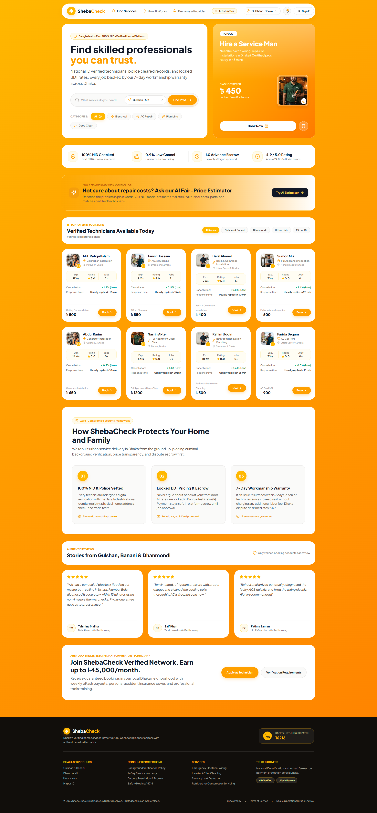
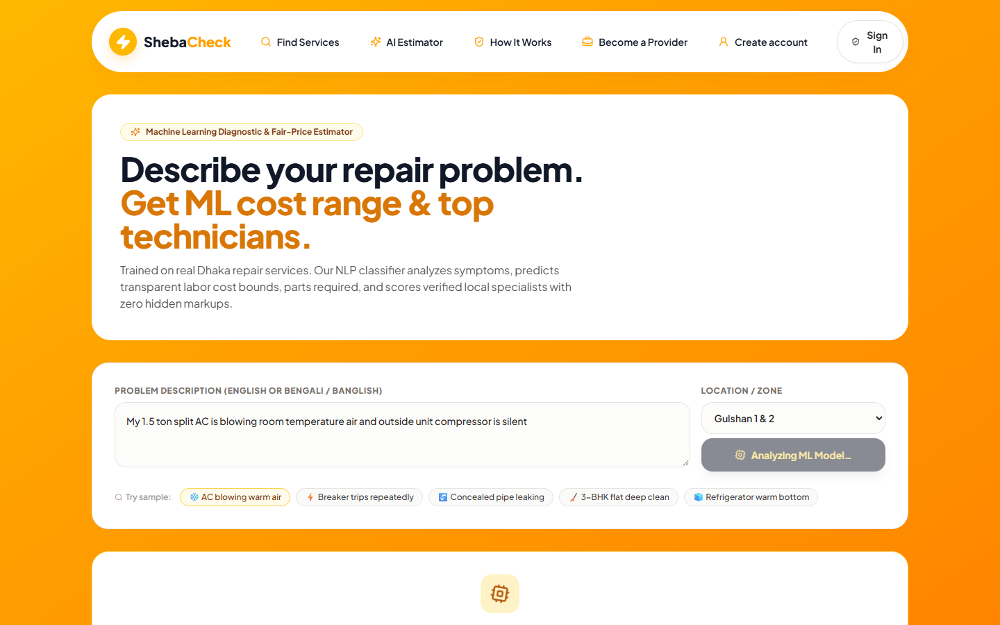
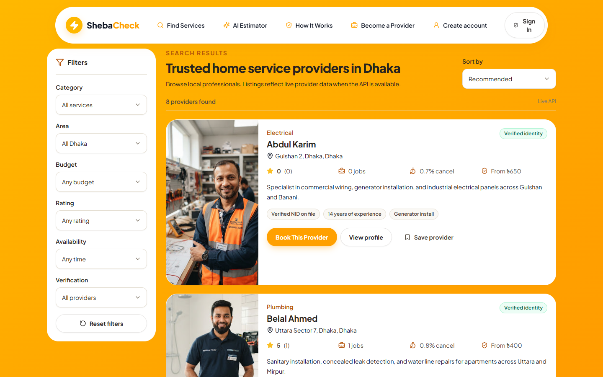
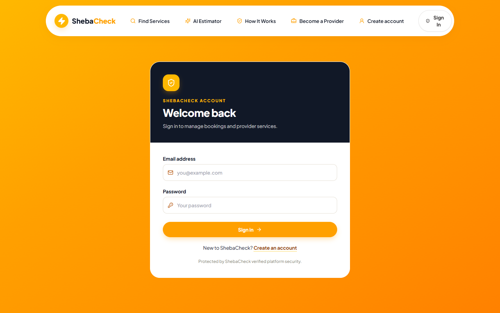
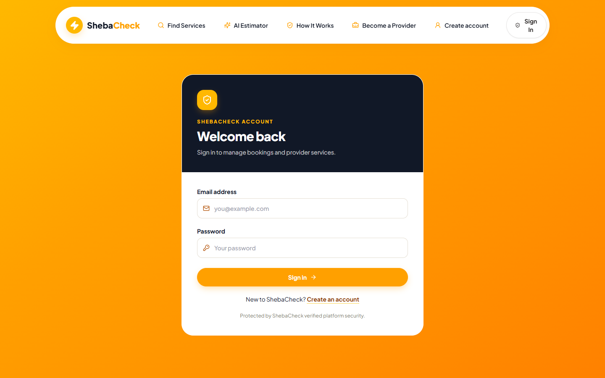

# ShebaCheck 🇧🇩

> **Verified Local Technician Marketplace & AI-Powered Diagnostic Platform for Dhaka, Bangladesh.**

ShebaCheck connects homeowners and businesses in Dhaka with thoroughly verified, professional electricians, plumbers, AC repair specialists, appliance mechanics, and cleaners. The platform replaces informal, unvetted service calls and arbitrary bargaining with **100% NID-verified technicians**, **locked-fee escrow payment protection**, and **real-time Machine Learning job diagnostics**.

---

## 📌 Visual Tour & Key Interfaces

### 1. Marketplace Homepage & Verified Technicians
*Curated Dhaka service zones (Gulshan, Banani, Dhanmondi, Uttara, Mirpur), live availability tags, and verified customer testimonials.*



---

### 2. AI Smart Diagnostic & Fair-Price Estimator (`/diagnostic`)
*Customers describe their repair problem in natural language (English, Bengali, or Banglish). A local Scikit-Learn NLP pipeline predicts the diagnostic category, expected fair labor cost bounds, repair time, required parts, and ranks the best-matched local specialists.*



---

### 3. Technician Discovery & Services Directory (`/search`)
*Comprehensive search directory with category filters, area selection, experience badges, price sorting, and rating filters.*



---

### 4. Provider Dashboard & Local AI OCR National ID Verification (`/provider-dashboard`)
*Self-service technician workspace featuring booking requests, service menu management, portfolio showcase, and a **100% local AI OCR National ID verification panel** that validates Bangladesh NID formatting, performs fuzzy name matching, and awards the verified badge instantly with zero 3rd-party API costs.*



---

### 5. Transparent Booking & Escrow Protection (`/booking`)
*Locked-fee booking schedule with appointment date selection, access instructions, transparent diagnostic fee breakdown, and bKash/Nagad escrow protection.*



---

## 🚀 Core Features

### 👤 Customer Experience
* **Verified Technician Discovery**: Browse verified professionals across Dhaka with transparent starting rates, verified customer ratings, and response times.
* **Smart Search & Filters**: Multi-criteria filtering by service category (Electrical, AC Repair, Plumbing, Appliance Repair, Deep Clean), location/zone, and price range.
* **AI Job Diagnostic & Fair-Price Estimator**: Instant machine learning analysis of repair symptoms with realistic cost range bounds to eliminate price gouging.
* **Locked Fee Escrow Booking**: Transparent price locking with appointment scheduling and clear access instructions.
* **Customer Dashboard**: Track active, upcoming, and completed service requests in real time.
* **Authentic Reviews**: Only verified customers who completed a genuine booking can leave a review and star rating.
* **Favorite Technicians**: Bookmark go-to local professionals for quick re-booking.

### 🛠️ Provider (Technician) Experience
* **Operational Dashboard**: Live overview of booking requests, upcoming jobs, monthly earnings, and customer reviews.
* **Booking Request Lifecycle**: Review incoming jobs, accept or decline requests, reschedule, and mark jobs as completed.
* **Self-Service AI OCR NID Verification**:
  * Upload photo/scan of Bangladesh Smart NID or laminated 10/13/17-digit card.
  * Instant local Computer Vision extraction of NID number, Date of Birth, and Holder Name.
  * Fuzzy token matching compares cardholder name against registered account name.
  * Automatic verified badge activation upon validation — zero waiting for manual admin approval.
* **Custom Service Catalog**: Add and edit specific service offerings and standard starting rates.
* **Availability Management**: Block out unavailable dates on a personal calendar to prevent scheduling conflicts.
* **Portfolio Showcase**: Upload completed job photos and descriptions to showcase craftsmanship.

### 🛡️ Trust & Administrative Operations
* **Operations Dashboard**: Real-time stats on total providers, active bookings, open disputes, and pending verifications.
* **Review Moderation Queue**: Automated anomaly detection flags suspicious or low-quality review submissions for operator review.
* **Dispute Resolution Workspace**: Track and resolve booking complaints with customer-provider communication audit trails.

---

## 🧠 Machine Learning & Document Intelligence

ShebaCheck incorporates two custom, fully local Machine Learning systems running natively in Python with **zero external API dependencies**:

### 1. Smart Job Diagnostic & Fair-Price Regressor (`apps/ml_estimator/`)
* **NLP Vectorization**: `TfidfVectorizer(ngram_range=(1, 2), sublinear_tf=True, strip_accents='unicode')` trained on a comprehensive corpus of Dhaka repair scenarios.
* **Diagnostic & Category Classifier**: `LogisticRegression` with calibrated class probabilities determining the failure category and specific diagnostic label.
* **Fair Price Regressor**: `Ridge(alpha=1.2)` regression model predicting continuous fair labor cost bounds (`price_min`, `price_estimate`, `price_max`) based on historical Dhaka service data.
* **Consumables Predictor**: Cosine similarity engine identifying required replacement parts and materials (e.g., *R410A Refrigerant*, *40A Double Pole MCB*, *PPR Pipe Elbows*) so customers avoid being overcharged.
* **Multi-Factor Provider Matcher**: Composite scoring algorithm matching active providers using:
  $$\text{Score} = w_1(\text{Category Match}) + w_2(\text{Area Proximity}) + w_3(\text{Rating}) + w_4(\text{NID Badge}) + w_5(\text{Price Proximity})$$

### 2. Local AI OCR & NID Document Intelligence (`apps/ml_estimator/nid_ocr.py`)
* **Image Preprocessing**: Pillow & NumPy pipeline applying aspect ratio normalization (ISO/IEC 7810 ID-1 standard), grayscale conversion, contrast stretching, and unsharp masking to separate text from guilloche security patterns.
* **Bangladesh NID Rule Validator**:
  * 10-digit Smart NID cards
  * 13-digit legacy cards
  * 17-digit cards (with 4-digit birth year prefix)
* **Fuzzy Name Matcher**: Hybrid token Jaccard similarity and character bigram analysis comparing the cardholder's name against the registered technician's account name.
* **Automated Self-Service Verification**: Automatically updates `identity_verified = True` and tags the provider with `"NID checked"` when the card passes format and name checks.

---

## 🏗️ Technology Stack

### Backend
| Technology | Description |
|---|---|
| **Python 3.14** | Core programming language |
| **Django 6.0** | Enterprise web framework |
| **Django REST Framework (DRF)** | RESTful API architecture |
| **SimpleJWT** | Stateless JWT authentication (access & refresh tokens) |
| **Scikit-Learn & NumPy** | Local Machine Learning & NLP pipelines |
| **Pillow (PIL)** | Computer vision & image preprocessing |
| **DRF Spectacular** | OpenAPI 3.0 specification & Swagger UI generation |
| **SQLite / PostgreSQL** | Relational database (SQLite for dev, Postgres ready) |

### Frontend
| Technology | Description |
|---|---|
| **React 19** | Component-based UI library |
| **TypeScript** | Strict static type checking |
| **Vite 6** | Ultra-fast build tool and dev server |
| **Tailwind CSS** | Design system with responsive tokens |
| **Framer Motion** | Micro-animations and page transitions |
| **Lucide React** | Modern UI iconography |
| **React Router DOM** | Client-side routing with protected route guards |

---

## 📂 Project Architecture

```
ShebaCheck/
├── backend/                        # Django REST API & ML Engine
│   ├── apps/
│   │   ├── api/                    # API routing & Swagger docs
│   │   ├── bookings/               # Booking lifecycle & escrow logic
│   │   ├── ml_estimator/           # Machine Learning & AI OCR Engine
│   │   │   ├── dataset.py          # Dhaka repair training corpus
│   │   │   ├── nid_ocr.py          # Local Computer Vision NID OCR engine
│   │   │   ├── pipeline.py         # TF-IDF, LogisticRegression & Ridge pipeline
│   │   │   ├── serializers.py      # ML request/response schemas
│   │   │   └── views.py            # /api/v1/ml/estimate/ endpoint
│   │   ├── providers/              # Provider profiles, services & verification
│   │   ├── reviews/                # Verified booking review system
│   │   ├── support/                # Dispute resolution system
│   │   └── users/                  # Custom User model & JWT authentication
│   ├── core/                       # Django project settings & configuration
│   └── manage.py
├── frontend/                       # React + TypeScript + Vite SPA
│   ├── src/
│   │   ├── api/                    # Strongly-typed API client & adapters
│   │   ├── auth/                   # JWT AuthProvider & session management
│   │   ├── components/             # Reusable UI components & design system
│   │   │   ├── home/               # Header, Hero, TechnicianCard, Footer
│   │   │   └── ui/                 # Buttons, Badges, Cards, Modals
│   │   ├── pages/
│   │   │   ├── admin/              # Admin operational workspace
│   │   │   ├── auth/               # Login & Registration flows
│   │   │   ├── customer/           # Home, Search, Profile, Booking, Diagnostic
│   │   │   └── provider/           # Provider Dashboard & NID verification panel
│   │   ├── App.tsx                 # Master routing & page switcher
│   │   └── types.ts                # TypeScript domain models
│   └── package.json
└── docs/
    └── screenshots/                # Application UI screenshots
```

---

## 🛠️ Installation & Local Setup

### Prerequisites
* **Python 3.11+** installed
* **Node.js 18+** & **npm** installed
* **Git** installed

---

### 1. Backend Setup

```bash
# 1. Navigate to the backend directory
cd backend

# 2. Create and activate a Python virtual environment
python -m venv .venv

# On Windows:
.venv\Scripts\activate
# On macOS/Linux:
source .venv/bin/activate

# 3. Install backend dependencies
pip install -r requirements.txt
pip install scikit-learn numpy scipy joblib

# 4. Apply database migrations
python manage.py migrate

# 5. Seed initial realistic Dhaka marketplace data
python manage.py seed_data

# 6. Start the Django development server
python manage.py runserver 127.0.0.1:8000
```
The API will be live at `http://127.0.0.1:8000/`.  
Interactive Swagger documentation is available at `http://127.0.0.1:8000/api/docs/`.

---

### 2. Frontend Setup

```bash
# 1. In a new terminal, navigate to the frontend directory
cd frontend

# 2. Install frontend dependencies
npm install

# 3. Start the Vite development server
npm run dev
```
The web application will be live at `http://localhost:5173/`.

---

## 🔑 Demo Credentials

The database comes pre-seeded with realistic Dhaka demo accounts:

| Role | Email | Password | Details |
|---|---|---|---|
| **Technician (Provider)** | `provider@shebacheck.com` | `Provider123!` | Md. Rafiqul Islam (Electrician, Mirpur 10) |
| **Customer** | `customer@shebacheck.com` | `Customer123!` | Fatima Zaman (Gulshan 1) |
| **Customer (Second)** | `tanvir.customer@shebacheck.com` | `Customer123!` | Saif Khan (Dhanmondi) |
| **Administrator** | `admin@shebacheck.com` | `Admin123!` | Platform Operations & Trust Team |

---

## 📡 API Reference Overview

| Module | Method | Endpoint | Description |
|---|---|---|---|
| **Auth** | `POST` | `/api/v1/auth/token/` | Obtain JWT access and refresh token pair |
| **Auth** | `POST` | `/api/v1/auth/register/` | Register new customer or provider account |
| **Auth** | `GET` | `/api/v1/auth/me/` | Get authenticated user profile |
| **ML** | `POST` | `/api/v1/ml/estimate/` | Natural language job diagnostic & fair price estimation |
| **Providers** | `GET` | `/api/v1/providers/` | Search and filter active verified providers |
| **Providers** | `GET` | `/api/v1/providers/{id}/` | Get full provider profile, portfolio, and services |
| **Providers** | `POST` | `/api/v1/providers/verify-nid/` | Local AI OCR National ID verification |
| **Providers** | `POST` | `/api/v1/providers/reset-nid/` | Reset NID verification status for testing |
| **Bookings** | `GET` | `/api/v1/bookings/` | List user bookings (filtered by role) |
| **Bookings** | `POST` | `/api/v1/bookings/` | Create a new service booking request |
| **Bookings** | `PATCH` | `/api/v1/bookings/{id}/status/` | Accept, decline, reschedule, or complete booking |
| **Reviews** | `GET` | `/api/v1/reviews/` | List published customer reviews |
| **Reviews** | `POST` | `/api/v1/reviews/` | Create review for a completed booking |
| **Support** | `GET/POST` | `/api/v1/support/disputes/` | Dispute management and resolution |

---

## 📄 License
This project is licensed under the MIT License.
